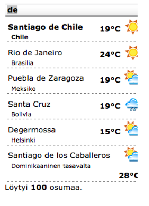

# smartmet-plugin-autocomplete

Part of [SmartMet Server](https://github.com/fmidev/smartmet-server). See the [SmartMet Server documentation](https://github.com/fmidev/smartmet-server) for a full overview of the ecosystem.

## Introduction

The SmartMet autocmplete plugin provides an efficient and a fast method
for completing the search locations.  It provides the location
information enriched with simple weather information.  The
figure below  shows how the autocomplete plugin suggests several
location information when  we start  to type a search location "de".




The main idea is to provide a
<a href="https://developers.google.com/maps/documentation/javascript/places-autocomplete">Google
Suggest type API</a> geographic information stored in the fminames
database. Autocomplete is a feature of the Places library in the
Google Maps JavaScript API. The autocomplete API can provide a
type-ahead-search behavior of the Google Maps search field. When a
user starts typing an address, autocomplete will fill in the rest.

## Main features

The main 
 features offered by  the plugin are as follows:
1.JSON output
2.Keyword identifies set of allowed locations
3.Language selection
4.Pretty printing for debugging purposes
5.Product specific customization of forecast parameters
6. Pagination of results


## Query string options

Below we describe the query string options. The default value for each option is given in parenthesis. If there is no default value specified, the option is compulsory.

### keyword

The keyword identifies the set of locations enabled in autocomplete. The allowed keywords are listed in

```
fminames.keywords
```

and the locations for each keyword in

```
fminames.keywords_has_geonames
```

Since Aug 4th 2021 the keyword may be a comma separated list. This enables one to join search results say from city names, amusement parks, golf courses etc.

There is a special case `keyword=all` which defines the set of places as *all places which belong to some known keyword*.


## pattern  

The pattern is the beginning of the location name usually
typed by the user. SmartMet server converts the UTF8 input to
iso-latin-8859-1 and to lower case to make comparisons
easier. The  collation sevices are in use.

### lang (fi) 

The selected language using a 2-character language ISO-code. If no specific translation exists for a location, the primary name for the location will be returned. The default comes from the `language` setting of the configuration file. A comma separated list of languages returns the names in each of the languages.


### max (15)  

The number of results to return in one page (at most 10000). The default comes from the `maxresults` setting of the configuration file.


### page (0)  

The page number. This option works in conjuction with the max option.

### feature, nofeature ()

A comma separated list of feature codes (for example `PPLC,PPLA`) of the locations to accept, or with `nofeature` to reject. The options cannot be used together.

### duplicates (0)

Return also locations whose names duplicate an earlier result.

### debug (0)

Add the score of each location to the output.


### format (json)  

This option is deprecated. PHP-serialization used to be supported, but the support was terminated when json_spirit was taken into use.

### pretty (0) 

Pretty print is used mostly for debugging purposes (and regression tests to spot changes more easily).

### product () 

Identify a product name to add localized forecast data to the output. The products and their
forecast parameters are listed in the `products` group of the configuration file:

```
products:
{
	weather = ["Temperature", "WeatherSymbol3"];
};
```

The default is not to include a forecast in the output.

### timeformat (iso)  

The output format as supported by MacGyver::TimeFormatter (iso, xml, timestamp, sql).

### locale (fi_FI)  

Localization may be used for formatting locale specific forecast parameters.

### time ()

Alternate forecast start time used only for creating static regression tests.

## Docker

SmartMet Server can be dockerized. This [tutorial](docs/docker.md)
explains how to explains how to configure the Autocomplete plugin of
the SmartMet Server when using Docker.
